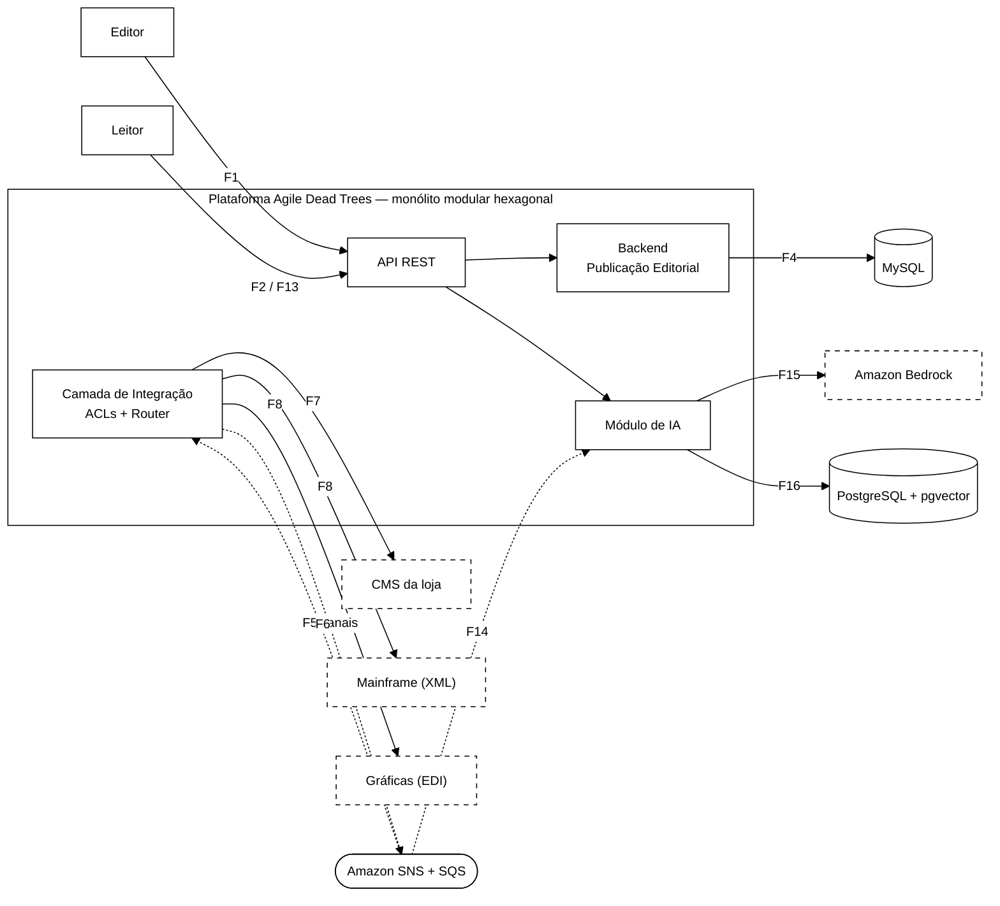

# Projeto Architectural Kata — Agile Dead Trees

**Disciplina:** Arquitetura de Software | **Período:** 6º Período — Engenharia de Software | UniSENAI / FIEP
**Turma:** Quarta-feira | **Sprint / Entrega:** Sprint 4 — Final do Projeto por Equipes (SGE2)
**Equipe:** Grupo Nexus (Equipe 5)

## Identificação da Equipe

| Nome do Integrante | Função na Sprint 4 | GitHub |
|---|---|---|
| Ricardo Betto | Líder & Arquiteto Principal | @github_ricardo |
| João Mota | Pesquisador & Modelagem DDD / Engenheiro de Resiliência & Integração | @github_joao |
| Renan Ribeiro | Executor & Especialista em IA-Native / QA & Desenvolvedor de Fitness Functions | @github_renan |

A equipe tem três integrantes, por isso os cinco papéis do modelo foram agrupados em três.

---

## 1. Visão Geral do Sistema e Domínio de Negócio

### 1.1. Contexto do Projeto Selecionado

- **Architectural Kata:** Agile Dead Trees (Editora Digital e E-commerce).
- **Desafio Principal de Engenharia:** orquestrar o fluxo de publicação híbrida (e-book e impressão física), conectando o CMS em nuvem a gráficas físicas legadas (via XML/EDI) e a um Agente de IA para recomendação e diagramação personalizada, mantendo o livro disponível na loja em até 10 minutos após a aprovação e suportando picos de cerca de 500 requisições por segundo.

### 1.2. Resumo da Solução Proposta

A plataforma é um **monólito modular com arquitetura hexagonal** ([ADR 004](adrs/004-monolito-modular-hexagonal.md)) em Node.js e TypeScript. O núcleo de Publicação Editorial contém só contratos e casos de uso e não depende de nenhuma tecnologia: tudo o que é externo (banco, mensageria, gráficas, loja, modelos de IA) é alcançado por portas e adaptadores, com distância da Sequência Principal D = 0 medida e verificada no pipeline ([ADR 003](adrs/003-refatoracao-dip-guiada-por-metricas.md)). O sistema foi dividido em cinco Bounded Contexts, e cada fronteira com sistema legado é uma **Camada Anti-Corrupção** feita de Adapters criados por **Factory Method** ([ADR 008](adrs/008-bounded-contexts-e-acl.md)): o mainframe recebe XML e as gráficas parceiras recebem EDI, sem que esses formatos cheguem ao núcleo.

O editor publica pela API (`POST /v1/publicacoes`, contrato-primeiro em OpenAPI, [ADR 005](adrs/005-contrato-primeiro-e-comunicacao.md)) e recebe 202 sem esperar nenhum legado. O evento `livro.publicado` sai por outbox para o **Amazon SNS + SQS** ([ADR 007](adrs/007-selecao-tecnologica-mensageria.md)), e um **Content-Based Router** ([ADR 009](adrs/009-content-based-router.md)) entrega cada livro só aos destinos que lhe interessam: vitrine, arquivo do e-book, gráfica e índice de IA. A chamada à gráfica é protegida por timeout, retry em dois níveis, circuit breaker e fallback ([ADR 006](adrs/006-resiliencia-mainframe.md)): se a gráfica cair, o livro continua na loja.

O **Agente de IA** ([ADR 010](adrs/010-componente-ia-native.md)) usa RAG sobre o catálogo (PostgreSQL com pgvector) e model tiering no Amazon Bedrock: um modelo pequeno para a recomendação, que é frequente e síncrona, e um modelo grande para a diagramação, que é rara e assíncrona. Guardrails removem dados pessoais, validam a saída por JSON Schema e descartam livros inventados; se a IA falhar, a recomendação cai para uma estratégia por regras, e nenhuma diagramação vai à gráfica sem aprovação do editor.

---

## 2. Atributos de Qualidade e Matriz QAW

Os atributos de qualidade prioritários foram definidos com base nos trade-offs essenciais do sistema. Detalhes, BOTE e trade-offs em [docs/qaw/atributos-de-qualidade.md](docs/qaw/atributos-de-qualidade.md).

| Atributo de Qualidade | Cenário Padronizado (Fonte → Estímulo → Artefato → Ambiente → Resposta) | Medida da Resposta (Métrica Objetivo) |
|---|---|---|
| Time-to-market | Editor → aprova um livro → fluxo de publicação → operação normal → publica e envia à vitrine | Livro à venda em até 10 minutos, sem redigitação |
| Interoperabilidade | CMS, planilha, mainframe ou gráfica → envia dados de um livro → Camadas Anti-Corrupção → operação normal → traduz e encaminha | 99% das integrações válidas sem intervenção manual |
| Escalabilidade | Leitores → lançamento de um livro → API, catálogo e recomendação → pico → réplicas sem estado e filas absorvem a carga | 500 req/s com as operações essenciais disponíveis |
| Disponibilidade / Resiliência | Mainframe ou provedor de IA → lentidão de 10 s ou 503 → gateway de impressão e recomendador → produção → circuit breaker e fallback | Circuito aberto em até 60 s; livro continua na loja; leitor nunca vê erro |
| Desempenho / Latência | Editor → `POST /v1/publicacoes` → API REST → pico de 500 req/s → responde 202 sem esperar o legado | p95 ≤ 300 ms; recomendação com timeout de 2 s antes do fallback |

---

## 3. Visão Geral da Arquitetura (Modelo C4)

A arquitetura está documentada conforme as abstrações do Modelo C4:

- 📄 [Nível 1 — Diagrama de Contexto](docs/c4-model/nivel1-contexto.md)
- 📄 [Nível 2 — Diagrama de Contêineres](docs/c4-model/nivel2-conteiner.md) (com a tabela dos 16 fluxos, protocolo e natureza temporal)
- 📄 [Nível 3 — Diagrama de Componentes](docs/c4-model/nivel3-componente.md)

### Visualização do Diagrama de Contêineres (C4 - Nível 2)



Linha contínua: síncrono. Linha tracejada: assíncrono.

---

## 4. Domain-Driven Design (DDD) & Limites de Contexto

Documentação completa em [docs/ddd/mapa-de-contexto.md](docs/ddd/mapa-de-contexto.md).

### 4.1. Classificação dos Subdomínios

- **Core Domain (Domínio Principal):** Publicação Editorial Híbrida — aprovação, regras e status da publicação em e-book e impresso.
- **Supporting Subdomain (Suporte):** Produção Gráfica; Distribuição Digital; Recomendação e Diagramação (IA); Dados Editoriais Legados.
- **Generic Subdomain (Genérico):** Identidade e Acesso (JWT/SSO), Pagamentos da loja (gateway terceirizado), Mensageria (SNS/SQS), Observabilidade (OpenTelemetry).

### 4.2. Mapa de Contexto e Camada Anti-Corrupção (ACL)

O sistema integra-se a serviços legados utilizando o padrão Anti-Corruption Layer (ACL) com a implementação de adaptadores GoF (Adapter Pattern) localizados em [`src/integracao/grafica`](src/integracao/grafica), isolando a Linguagem Ubíqua do núcleo do sistema. A Publicação Editorial é upstream e publica o evento `livro.publicado` como Published Language (schema `Livro` do OpenAPI); Produção Gráfica, Distribuição Digital e IA são downstream. O padrão EIP **Content-Based Router** que distribui esse evento está em [docs/eip/content-based-router.md](docs/eip/content-based-router.md).

---

## 5. Padrões de Projeto & Princípios SOLID

### 5.1. Princípios SOLID Aplicados

- **Dependency Inversion Principle (DIP):** o domínio declara interfaces de repositórios e serviços ([`src/backend/regras-de-negocio/portas.ts`](src/backend/regras-de-negocio/portas.ts)), enquanto a infraestrutura provê a implementação concreta ([`src/integracao`](src/integracao)). Resultado medido: D = 0 nos pacotes do fluxo de publicação (ADR 003).
- **Open/Closed Principle (OCP):** uma gráfica nova entra com uma subclasse de `CanalGrafica`; um canal novo de distribuição entra com uma linha no roteador; uma estratégia nova de recomendação entra com uma classe nova — sem alterar as classes existentes.
- **Single Responsibility Principle (SRP):** tradução do legado (adapters), resiliência (decorator) e regra de roteamento (router) ficam em classes separadas.

### 5.2. Catálogo de Padrões GoF Utilizados

| Padrão GoF | Categoria | Localização no Código | Problema de Engenharia Resolvido |
|---|---|---|---|
| Factory Method | Criacional | [`src/integracao/grafica/canal-grafica.ts`](src/integracao/grafica/canal-grafica.ts) | Instanciação do conector de cada gráfica sem acoplamento a classes concretas, sempre com resiliência aplicada |
| Adapter | Estrutural | [`mainframe-xml-adapter.ts`](src/integracao/grafica/mainframe-xml-adapter.ts), [`grafica-edi-adapter.ts`](src/integracao/grafica/grafica-edi-adapter.ts) | Tradução da `SolicitacaoImpressao` do domínio para XML e EDI dos sistemas legados, e da resposta de volta |
| Decorator | Estrutural | [`impressora-gateway-resiliente.ts`](src/integracao/grafica/impressora-gateway-resiliente.ts) | Timeout e circuit breaker sem alterar o adapter nem o núcleo |
| State | Comportamental | [`disjuntor.ts`](src/integracao/grafica/disjuntor.ts) | Estados fechado, aberto e meio-aberto do circuit breaker sem condicionais espalhadas |
| Strategy | Comportamental | [`src/ia/recomendacao`](src/ia/recomendacao) | Alternância entre recomendação por IA e por regras sem `if/else` |
| Observer | Comportamental | SNS + SQS ([ADR 007](adrs/007-selecao-tecnologica-mensageria.md)) | Vários consumidores reagem à publicação de um livro sem que o publicador os conheça |

---

## 6. Resiliência, Integração e IA-Native

### 6.1. Padrões de Resiliência Aplicados

- **Circuit Breaker & Fallback:** implementado como decorador da porta `ImpressoraGateway` (biblioteca opossum em produção; versão didática em `disjuntor.ts`) nas chamadas síncronas ao mainframe e às gráficas, com janela de 60 s, abertura com 50% de falhas e 30 s aberto. Com o circuito aberto, a impressão é adiada (`AGUARDANDO_GRAFICA`) e o livro continua na loja ([ADR 006](adrs/006-resiliencia-mainframe.md)).
- **Timeout e Retry em dois níveis:** 1 s de conexão e 5 s de resposta; 3 tentativas com backoff exponencial e jitter no consumidor e reentregas da fila após 1, 5 e 15 minutos.
- **Nivelamento de Carga (Load Leveling):** a mensageria assíncrona (SNS + SQS) absorve picos de concorrência, com filas Dead Letter Queue (DLQ) atreladas e alerta para qualquer mensagem em DLQ.
- **Roteamento por conteúdo:** o Content-Based Router ([ADR 009](adrs/009-content-based-router.md)) isola as filas por destino, então uma gráfica lenta não atrasa a vitrine.

### 6.2. Componente de Inteligência Artificial Generativa

Documentação completa em [docs/ia/componente-ia.md](docs/ia/componente-ia.md).

- **Arquitetura AI-Native:** RAG sobre o catálogo (embeddings em PostgreSQL com pgvector) e Model Tiering no Amazon Bedrock — Tier 1 (modelo pequeno) para recomendação síncrona; Tier 2 (modelo grande) para diagramação personalizada assíncrona, com aprovação do editor.
- **Guardrails & Segurança:** saídas estruturadas validadas via JSON Schema (com os enums do contrato OpenAPI), higienização prévia de PII antes do envio aos modelos, descarte de ISBN fora dos candidatos recuperados (anti-alucinação), teto de tokens e alerta de orçamento. Fallback por Strategy para recomendação por regras.

---

## 7. Registros de Decisões Arquiteturais (ADRs)

Todas as decisões estratégicas e seus trade-offs estão registrados na pasta [`adrs/`](adrs):

| ADR | Título da Decisão Arquitetural | Status | Data |
|---|---|---|---|
| [ADR-001](adrs/001-camada-de-integracao.md) | Camada de integração para sistemas legados | Aceito | 2026-08 (Sprint 1) |
| [ADR-002](adrs/002-processamento-assincrono.md) | Eventos assíncronos no processo de publicação | Aceito | 2026-08 (Sprint 1) |
| [ADR-003](adrs/003-refatoracao-dip-guiada-por-metricas.md) | Refatoração dos componentes por DIP guiada por métricas | Aceito | 2026-10 (Sprint 2) |
| [ADR-004](adrs/004-monolito-modular-hexagonal.md) | Estilo arquitetural: monólito modular hexagonal com eventos | Aceito | 2026-10 (Sprint 2) |
| [ADR-005](adrs/005-contrato-primeiro-e-comunicacao.md) | Contrato-primeiro e regra de comunicação síncrona/assíncrona | Aceito (item 2 substituído pela ADR 007) | 2026-10 (Sprint 3) |
| [ADR-006](adrs/006-resiliencia-mainframe.md) | Resiliência ativa na integração com o mainframe de impressão | Aceito | 2026-10 (Sprint 3) |
| [ADR-007](adrs/007-selecao-tecnologica-mensageria.md) | Seleção tecnológica da stack de Mensageria: Amazon SQS com SNS | Aceito | 2026-11 (Sprint 4) |
| [ADR-008](adrs/008-bounded-contexts-e-acl.md) | Bounded Contexts e Camada Anti-Corrupção com Adapter e Factory Method | Aceito | 2026-11 (Sprint 4) |
| [ADR-009](adrs/009-content-based-router.md) | Content-Based Router para o fluxo de publicação híbrida | Aceito | 2026-11 (Sprint 4) |
| [ADR-010](adrs/010-componente-ia-native.md) | Agente de IA: RAG, Model Tiering e Guardrails | Aceito | 2026-11 (Sprint 4) |

---

## 8. Testes & Fitness Functions (Governança Automatizada)

### 8.1. Execução das Fitness Functions

Para garantir que as regras de dependência entre camadas não sejam violadas no código, executamos testes de arquitetura automatizados (dependency-cruiser e `node:test`, equivalentes ao ArchUnit no ecossistema Node.js). Detalhes em [docs/fitness-functions/fitness-functions.md](docs/fitness-functions/fitness-functions.md).

```bash
npm install
npm test                 # 21 testes: arquitetura, ACL, router, circuit breaker, guardrails de IA
npm run test:arquitetura # dependency-cruiser
```

- **Regra Validada 1:** a camada de Domínio (`src/backend/regras-de-negocio`) não possui referência direta para a camada de Infraestrutura nem para nenhum outro pacote.
- **Regra Validada 2:** toda dependência externa do núcleo é uma interface abstrata (`ImpressoraGateway`, `PublicadorEventos`) implementada fora dele.
- **Regra Validada 3:** formatos legados (XML, EDI, SFTP) só existem dentro da Camada Anti-Corrupção.
- **Regra Validada 4:** os canais do Content-Based Router são os mesmos das filter policies do SNS.
- **Regra Validada 5:** todo canal de gráfica criado pelo Factory Method sai envolvido na resiliência.

Resultado da última execução: **21 testes aprovados, 0 falhas; nenhuma violação de dependência**. A Regra 1 foi testada com uma violação proposital, que bloqueou o build como esperado.

---

## Estrutura do repositório

```
README.md
adrs/                    ADRs 001 a 010
docs/c4-model/           C4 níveis 1, 2 e 3
docs/ddd/                Subdomínios, Bounded Contexts e Mapa de Contexto
docs/eip/                Content-Based Router
docs/ia/                 Componente de IA
docs/qaw/                Atributos de qualidade
docs/fitness-functions/  Testes e governança
src/                     Código demonstrativo (TypeScript)
test/                    Testes
infra/                   Filter policies do SNS
```
