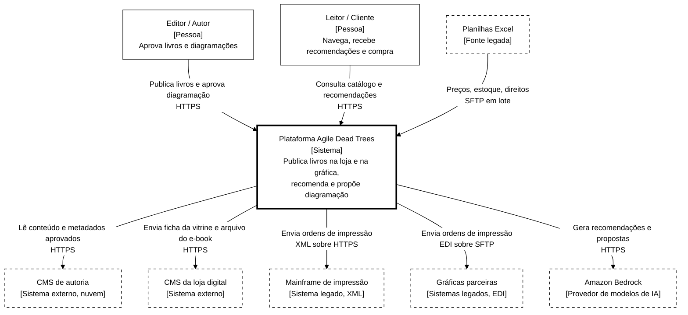

# C4 Nível 1 — Diagrama de Contexto

Projeto Agile Dead Trees — Editora Digital (Grupo Nexus). Versão final (Sprint 4). A primeira versão foi feita na Sprint 1; esta acrescenta as gráficas parceiras (EDI) e o provedor de modelos de IA.

| Elemento | Papel |
|---|---|
| Editor / Autor | Solicita a publicação (e-book, impresso ou híbrido) e aprova a proposta de diagramação da IA. |
| Leitor / Cliente | Usa a loja: catálogo, recomendações e compra. |
| CMS de autoria | Origem do conteúdo e dos metadados aprovados. |
| CMS da loja digital | Vitrine e venda; recebe a ficha do livro e o arquivo do e-book. |
| Mainframe de impressão | Gráfica própria legada; recebe ordens em XML pelo gateway. |
| Gráficas parceiras | Gráficas externas; trocam arquivos EDI por SFTP. |
| Planilhas Excel | Dados legados de preço, estoque, direitos e contratos. |
| Amazon Bedrock | Modelos de linguagem e de embeddings usados pelo agente de IA ([ADR 010](../../adrs/010-componente-ia-native.md)). |
