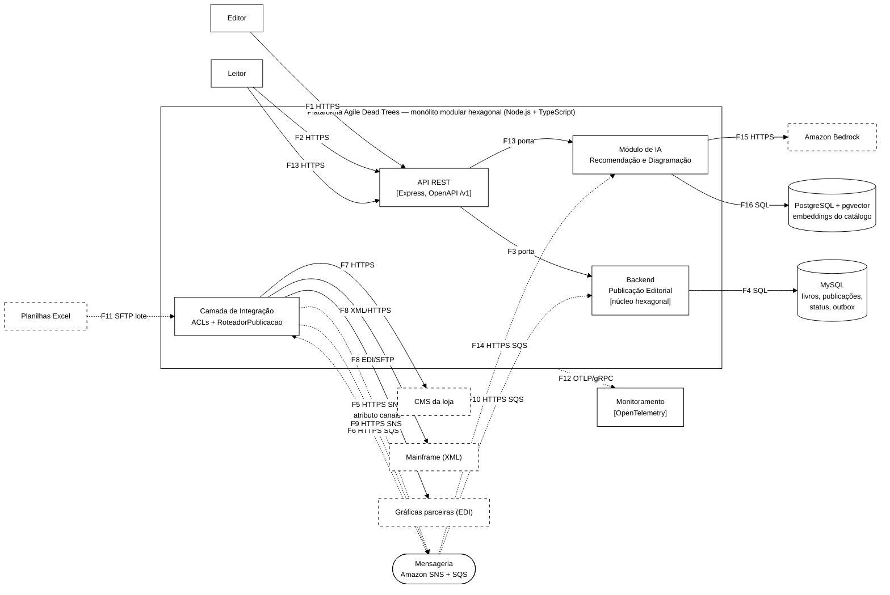

# C4 Nível 2 — Diagrama de Contêineres

Projeto Agile Dead Trees — Editora Digital (Grupo Nexus). Versão final (Sprint 4), consolidando a Sprint 1 (contêineres), a Sprint 3 (protocolos e natureza temporal dos fluxos), a [ADR 007](../../adrs/007-selecao-tecnologica-mensageria.md) (SNS + SQS), a [ADR 009](../../adrs/009-content-based-router.md) (roteamento por conteúdo) e a [ADR 010](../../adrs/010-componente-ia-native.md) (IA).

API REST, Backend, Camada de Integração e Módulo de IA são **módulos do mesmo artefato implantável** ([ADR 004](../../adrs/004-monolito-modular-hexagonal.md)). As setas entre eles são chamadas em processo pelas portas da [ADR 003](../../adrs/003-refatoracao-dip-guiada-por-metricas.md).

Linha contínua: síncrono (quem chama espera). Linha tracejada: assíncrono.

## Contêineres

| Contêiner | Tecnologia | Responsabilidade |
|---|---|---|
| API REST | Node.js, Express, express-openapi-validator | Fronteira HTTP; valida o contrato `/v1` ([ADR 005](../../adrs/005-contrato-primeiro-e-comunicacao.md)). |
| Backend — Publicação Editorial | TypeScript, núcleo hexagonal | Regras e casos de uso da publicação; grava o evento na outbox. |
| Camada de Integração | TypeScript, AWS SDK, cliente SFTP | ACLs dos sistemas externos ([ADR 008](../../adrs/008-bounded-contexts-e-acl.md)), Content-Based Router e publicador SNS ([ADR 009](../../adrs/009-content-based-router.md)), consumidores SQS com resiliência ([ADR 006](../../adrs/006-resiliencia-mainframe.md)). |
| Módulo de IA | TypeScript, Amazon Bedrock | RAG, model tiering e guardrails ([ADR 010](../../adrs/010-componente-ia-native.md)). |
| MySQL | MySQL | Dados transacionais e tabela outbox. |
| PostgreSQL + pgvector | PostgreSQL | Banco vetorial do catálogo (índice HNSW). |
| Mensageria | Amazon SNS + SQS | Tópico `livro-publicado` com filtro por `canais`; filas `loja-atualizar`, `ebook-distribuir`, `impressao-solicitar`, `ia-indexar`, `ia-diagramar` e DLQs. |
| Monitoramento | OpenTelemetry | Métricas, logs e traces de todos os fluxos. |

## Fluxos

| Fluxo | Origem → destino | Protocolo | Natureza | O que trafega |
|---|---|---|---|---|
| F1 | Editor → API REST | HTTPS, REST/JSON | Síncrono | `POST /v1/publicacoes`, resposta 202 |
| F2 | Leitor → API REST | HTTPS, REST/JSON | Síncrono | Catálogo e pedidos |
| F3 | API REST → Backend | Chamada em processo | Síncrono | `Livro` validado (`PublicarLivroUseCase`) |
| F4 | Backend → MySQL | MySQL/TCP | Síncrono | Publicação, status e outbox na mesma transação |
| F5 | Integração → SNS | HTTPS (AWS SDK) | Assíncrono | `livro.publicado` com atributo `canais` |
| F6 | SQS → Integração | HTTPS (AWS SDK), long polling | Assíncrono | Mensagens de `loja-atualizar`, `ebook-distribuir`, `impressao-solicitar` |
| F7 | Integração → CMS da loja | HTTPS, REST/JSON | Síncrono dentro do assíncrono | Ficha da vitrine e arquivo do e-book |
| F8 | Integração → Mainframe / gráficas | XML/HTTPS ou EDI/SFTP | Síncrono dentro do assíncrono | Ordem de impressão (com resiliência da ADR 006) |
| F9 | Integração → SNS | HTTPS | Assíncrono | `impressao.solicitada`, `impressao.adiada`, `impressao.concluida` |
| F10 | SQS → Backend | HTTPS | Assíncrono | Atualização de status |
| F11 | Planilhas → Integração | SFTP, lote agendado | Assíncrono | Preço, estoque, direitos |
| F12 | Todos → Monitoramento | OTLP sobre gRPC | Assíncrono | Métricas, logs, traces |
| F13 | Leitor → API → IA | HTTPS + chamada em processo | Síncrono (timeout 2 s, fallback) | Pedido de recomendação |
| F14 | SQS → IA | HTTPS | Assíncrono | `ia-indexar` (livro publicado) e `ia-diagramar` (pedido do editor) |
| F15 | IA → Amazon Bedrock | HTTPS | Síncrono dentro de F13 ou F14 | Prompt higienizado e resposta estruturada |
| F16 | IA → PostgreSQL + pgvector | SQL | Síncrono | Busca por similaridade e gravação de embeddings |

Mudanças em relação à Sprint 3: F5, F6, F9 e F10 passaram de AMQP para HTTPS (ADR 007); F8 passou a usar XML e EDI (ADR 008); F13 a F16 são novos (ADR 010); a entrega de F6 passou a ser filtrada por conteúdo (ADR 009).
