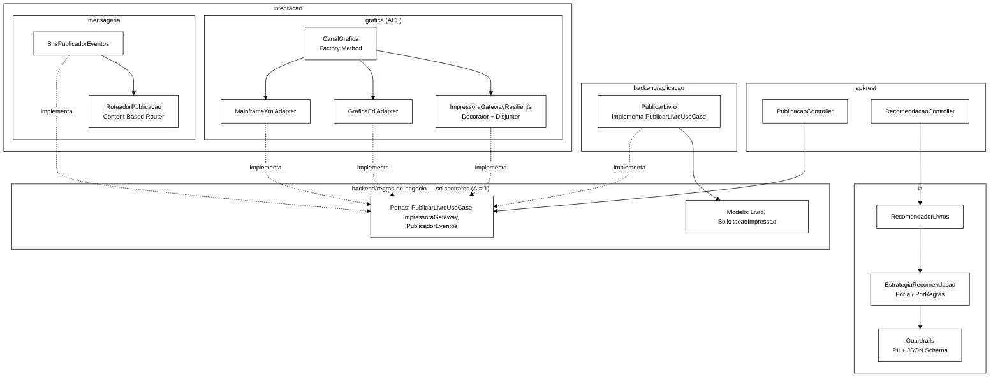

# C4 Nível 3 — Diagrama de Componentes

Projeto Agile Dead Trees — Editora Digital (Grupo Nexus). Componentes do artefato da plataforma, com os pacotes da Sprint 2 ([ADR 003](../../adrs/003-refatoracao-dip-guiada-por-metricas.md)) e os módulos dos Bounded Contexts ([ADR 008](../../adrs/008-bounded-contexts-e-acl.md)). Cada caixa corresponde a uma pasta em `src/`.

## Regras de dependência (verificadas no pipeline)

| Pacote | Pode importar | Não pode importar |
|---|---|---|
| `backend/regras-de-negocio` | nada | qualquer outro pacote |
| `backend/aplicacao` | `regras-de-negocio` | `api-rest`, `integracao`, `ia` |
| `api-rest` | `regras-de-negocio`, `ia` (só a porta de recomendação) | `integracao` |
| `integracao` | `regras-de-negocio` | `aplicacao`, `api-rest`, `ia` |
| `ia` | o próprio módulo | `backend`, `integracao` |

As setas apontam sempre para os contratos do núcleo, o que mantém D = 0 nos pacotes do fluxo de publicação ([ADR 003](../../adrs/003-refatoracao-dip-guiada-por-metricas.md)). A montagem das implementações fica no composition root (`src/main.ts`), único arquivo autorizado a importar classes concretas de todos os módulos.
