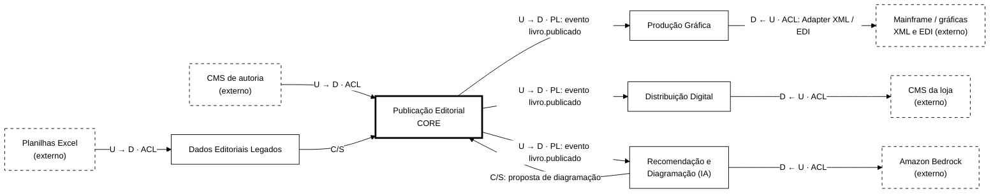
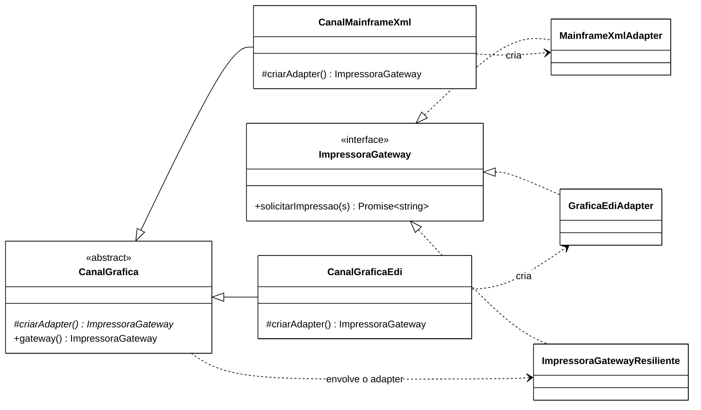

# Domain-Driven Design — Subdomínios, Bounded Contexts e Mapa de Contexto

Projeto Agile Dead Trees — Editora Digital (Grupo Nexus). Decisão registrada na [ADR 008](../../adrs/008-bounded-contexts-e-acl.md).

## 1. Classificação dos subdomínios

| Tipo | Subdomínio | Por que tem esse tipo |
|---|---|---|
| **Core Domain** | Publicação Editorial Híbrida | É o que diferencia a editora: levar um livro aprovado à loja em até 10 minutos e, quando houver versão impressa, à gráfica, sem redigitação. É onde a equipe investe mais design (núcleo hexagonal, D = 0). |
| **Supporting** | Produção Gráfica | Necessário para o negócio, mas sem vantagem competitiva própria: transforma uma publicação em ordem de impressão e acompanha o status. |
| **Supporting** | Distribuição Digital | Entrega a ficha da vitrine e o arquivo do e-book ao CMS da loja. |
| **Supporting** | Recomendação e Diagramação (IA) | Agrega valor à loja e à produção, mas depende de modelos de terceiros ([ADR 010](../../adrs/010-componente-ia-native.md)). |
| **Supporting** | Dados Editoriais Legados | Carga de preços, estoque, direitos e contratos das planilhas Excel. |
| **Generic** | Identidade e Acesso | Autenticação JWT/SSO com serviço pronto. |
| **Generic** | Pagamentos da loja | Gateway de pagamento terceirizado, dentro da loja. |
| **Generic** | Mensageria | Amazon SNS + SQS ([ADR 007](../../adrs/007-selecao-tecnologica-mensageria.md)). |
| **Generic** | Observabilidade | OpenTelemetry e monitoramento. |

## 2. Bounded Contexts e linguagem ubíqua

| Bounded Context | Termos da linguagem ubíqua | Módulo no código |
|---|---|---|
| **Publicação Editorial** | Livro, Publicação, Formato (`EBOOK`, `IMPRESSO`), StatusPublicacao (`RECEBIDA`, `DISPONIVEL_NA_LOJA`, `FALHA`) | `src/backend/regras-de-negocio`, `src/backend/aplicacao`, `src/api-rest` |
| **Produção Gráfica** | SolicitacaoImpressao, Tiragem, FormatoPapel, Acabamento, StatusImpressao (`SOLICITADA`, `AGUARDANDO_GRAFICA`, `EM_PRODUCAO`, `CONCLUIDA`, `FALHA`) | `src/integracao/grafica` |
| **Distribuição Digital** | FichaVitrine, ArquivoEbook | `src/integracao/loja` |
| **Recomendação e Diagramação** | Recomendação, Candidato, PropostaDiagramacao | `src/ia` |
| **Dados Editoriais Legados** | Carga de planilha, Linha rejeitada | `src/integracao/planilhas` |

O mesmo termo pode mudar de significado entre contextos. Exemplo: para a Publicação, `Livro` é a obra aprovada com seus formatos; para a gráfica legada, o equivalente é um "job" com código de papel e quantidade; para o CMS da loja, é um "produto" com preço e estoque. Cada tradução acontece em uma Camada Anti-Corrupção, nunca no núcleo.

## 3. Mapa de Contexto

Legenda: **U** = upstream (fornece o modelo), **D** = downstream (consome). **PL** = Published Language, **ACL** = Anti-Corruption Layer, **C/S** = Customer/Supplier. Retângulos tracejados são sistemas externos.

### Relações

| De → Para | Padrão | Como funciona |
|---|---|---|
| CMS de autoria → Publicação | **ACL** | O adaptador do CMS traduz metadados e o arquivo aprovado para o `Livro` do contrato ([ADR 005](../../adrs/005-contrato-primeiro-e-comunicacao.md)). |
| Planilhas → Dados Legados → Publicação | **ACL** + **Customer/Supplier** | A carga por SFTP (F11) valida cada linha; linhas inválidas são rejeitadas com relatório, nunca entram no núcleo. |
| Publicação → Produção Gráfica, Distribuição Digital e IA | **Published Language** | O evento `livro.publicado` usa o schema `Livro` do OpenAPI. A entrega é feita pelo Content-Based Router ([ADR 009](../../adrs/009-content-based-router.md)). |
| IA → Publicação | **Customer/Supplier** | A IA devolve uma proposta de diagramação; só vira `SolicitacaoImpressao` depois da aprovação do editor. |
| Produção Gráfica → Mainframe e gráficas | **ACL** | `MainframeXmlAdapter` (XML pelo gateway do mainframe) e `GraficaEdiAdapter` (EDI por SFTP), criados por Factory Method. Ver seção 4. |
| Distribuição Digital → CMS da loja | **ACL** | O adaptador traduz `Livro` para o "produto" da loja e envia o arquivo do e-book. |
| IA → Amazon Bedrock | **ACL** | Porta `ModeloLinguagemGateway`; prompts e respostas nunca chegam ao núcleo. |

## 4. Camada Anti-Corrupção (ACL) da Produção Gráfica

A ACL fica em `src/integracao/grafica`. O núcleo só conhece a porta `ImpressoraGateway` ([ADR 003](../../adrs/003-refatoracao-dip-guiada-por-metricas.md)).

- **Adapter (GoF):** traduz `SolicitacaoImpressao` (linguagem ubíqua) para o documento do legado e a resposta do legado de volta para um id de solicitação.
- **Factory Method (GoF):** `CanalGrafica.criarAdapter()` é o método-fábrica; `gateway()` sempre envolve o adapter no `ImpressoraGatewayResiliente` ([ADR 006](../../adrs/006-resiliencia-mainframe.md)).
- **Tradução de exemplo:** o campo `tiragem` vira `<QTD>` no XML do mainframe e o segmento `QTY+21:` no EDI; `formatoPapel` `14x21` vira o código de papel `P1421`.

## 5. Evolução em relação às sprints anteriores

- A **camada de integração** da Sprint 1 ([ADR 001](../../adrs/001-camada-de-integracao.md)) é a ACL desta seção, agora com fronteiras de contexto explícitas.
- Os **pacotes da Sprint 2** (`ApiRest`, `Backend.RegrasDeNegocio`, `Backend.Aplicacao`, `Integracao`) continuam os mesmos; o pacote `Integracao` agora está dividido por contexto (`grafica`, `loja`, `planilhas`, `mensageria`).
- O **contrato da Sprint 3** é a Published Language entre os contextos.
- A **premissa da Sprint 3** de que o gateway do mainframe aceitaria REST/JSON não se confirmou: ele usa XML. A mudança ficou contida no adapter, sem tocar no núcleo, que é exatamente o que a ACL promete.
