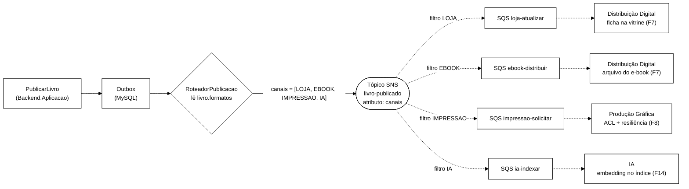

# EIP — Content-Based Router da publicação híbrida

Projeto Agile Dead Trees — Editora Digital (Grupo Nexus). Decisão registrada na [ADR 009](../../adrs/009-content-based-router.md).

## 1. Problema

Um livro aprovado pode ser só e-book, só impresso ou híbrido. Cada caso aciona destinos diferentes: a vitrine da loja, a entrega do arquivo digital, a gráfica e o índice de recomendação da IA. No fanout simples da [ADR 007](../../adrs/007-selecao-tecnologica-mensageria.md), todo livro ia para todas as filas e cada consumidor decidia sozinho se a mensagem lhe interessava.

## 2. Padrão aplicado

**Content-Based Router** (Hohpe e Woolf, livro "Enterprise Integration Patterns"): um componente examina o conteúdo da mensagem e a encaminha ao canal correto, sem que o remetente ou os destinatários conheçam a regra.

Linha contínua: chamada síncrona. Linha tracejada: entrega assíncrona.

## 3. Regra de roteamento

| Condição no conteúdo do `Livro` | Canal | Fila |
|---|---|---|
| sempre | `LOJA` | `loja-atualizar` |
| `formatos` contém `EBOOK` | `EBOOK` | `ebook-distribuir` |
| `formatos` contém `IMPRESSO` | `IMPRESSAO` | `impressao-solicitar` |
| sempre | `IA` | `ia-indexar` |

Exemplos:

| Livro | `formatos` | Canais |
|---|---|---|
| E-book puro | `[EBOOK]` | `LOJA`, `EBOOK`, `IA` |
| Só impresso | `[IMPRESSO]` | `LOJA`, `IMPRESSAO`, `IA` |
| Híbrido | `[EBOOK, IMPRESSO]` | `LOJA`, `EBOOK`, `IMPRESSAO`, `IA` |

## 4. Implementação

- **Regra:** `src/integracao/mensageria/roteador-publicacao.ts` — função pura `rotearPublicacao(livro)`, com teste unitário.
- **Publicação:** `src/integracao/mensageria/sns-publicador-eventos.ts` — grava os canais no atributo `canais` (`String.Array`) da mensagem SNS. O envio sai da tabela outbox, como definido na ADR 007.
- **Entrega:** `infra/sns-filter-policies.json` — uma filter policy por assinatura SQS, por exemplo `{"canais": ["IMPRESSAO"]}` para `impressao-solicitar`. O SNS entrega a mensagem quando algum valor da lista `canais` coincide com o filtro.

## 5. Relação com os outros padrões

- **Published Language:** o roteador lê o mesmo schema `Livro` da [ADR 005](../../adrs/005-contrato-primeiro-e-comunicacao.md).
- **Resiliência:** a fila `impressao-solicitar` continua com retry, DLQ e circuit breaker da [ADR 006](../../adrs/006-resiliencia-mainframe.md), agora só com livros impressos.
- **Load Leveling:** cada fila absorve os picos do seu consumidor de forma independente; um atraso na gráfica não atrasa a vitrine.
- **Fitness function:** um teste compara o enum `Canal` do código com as filter policies e falha o build se houver divergência (ver [fitness functions](../fitness-functions/fitness-functions.md)).
