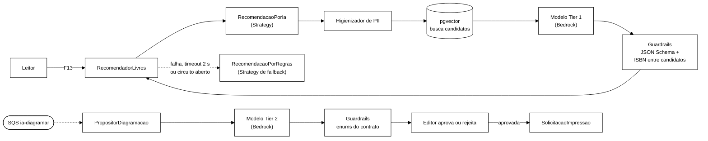

# Componente de IA — Recomendação e Diagramação (AI-Native)

Projeto Agile Dead Trees — Editora Digital (Grupo Nexus). Decisão registrada na [ADR 010](../../adrs/010-componente-ia-native.md). Código em `src/ia`.

## 1. Os dois casos de uso

| Caso de uso | Quem pede | Fluxo | Natureza | Modelo (tier) |
|---|---|---|---|---|
| Recomendação de livros | Leitor, na loja | F13 | Síncrono, timeout de 2 s | Tier 1 — modelo pequeno |
| Diagramação personalizada | Editor, para livros impressos | F14 (fila `ia-diagramar`) | Assíncrono | Tier 2 — modelo grande |

Além disso, todo livro publicado chega pela fila `ia-indexar` (Content-Based Router, [ADR 009](../../adrs/009-content-based-router.md)) e tem a sinopse e os metadados transformados em embedding no banco vetorial.

## 2. Arquitetura

## 3. RAG (Retrieval-Augmented Generation)

1. **Indexação** (fila `ia-indexar`): título, autores, sinopse, idioma e categoria do `Livro` viram um embedding gravado no PostgreSQL com pgvector (índice HNSW).
2. **Recuperação:** a partir do histórico do leitor (lista de ISBNs, sem dados pessoais), o agente busca os 20 livros mais próximos que ele ainda não comprou.
3. **Geração:** o modelo Tier 1 recebe só esses 20 candidatos e devolve até 5 ISBNs com uma justificativa curta. Ele não pode sugerir nada fora da lista.

## 4. Model Tiering

| Tier | Uso | Por que |
|---|---|---|
| Tier 1 — modelo pequeno | Recomendação (alta frequência, picos de 500 req/s na loja) | Baixa latência e baixo custo por chamada |
| Tier 2 — modelo grande | Diagramação (baixa frequência, raciocínio sobre gênero, público e número de páginas) | Qualidade da proposta compensa o custo; não há usuário esperando |

O nome de cada modelo fica em variável de ambiente (`IA_MODELO_TIER1`, `IA_MODELO_TIER2`), não no código.

## 5. Guardrails

| Guardrail | O que faz | Onde |
|---|---|---|
| Higienização de PII | Remove e-mail, CPF e telefone de qualquer texto; o histórico do leitor vai só como ISBNs | `src/ia/guardrails/higienizador-pii.ts` |
| Saída estruturada | A resposta do modelo precisa ser JSON válido no schema esperado; caso contrário é descartada | `src/ia/guardrails/validador-saida.ts` |
| Aterramento no catálogo | ISBN recomendado que não está entre os candidatos é removido | `src/ia/recomendacao/recomendacao-por-ia.ts` |
| Enums do contrato | `formatoPapel` só aceita `14x21`, `16x23` ou `A5`; `acabamento` só `BROCHURA` ou `CAPA_DURA` ([ADR 005](../../adrs/005-contrato-primeiro-e-comunicacao.md)) | `src/ia/guardrails/validador-saida.ts` |
| Humano no circuito | Proposta de diagramação só vira ordem de impressão depois da aprovação do editor | Caso de uso de diagramação |
| Limite de custo | Teto de tokens por chamada e alerta de orçamento mensal | Configuração e monitoramento |

## 6. Resiliência

- A chamada ao modelo tem timeout e circuit breaker, no mesmo padrão de decorador da [ADR 006](../../adrs/006-resiliencia-mainframe.md).
- Na recomendação, qualquer falha troca a Strategy para `RecomendacaoPorRegras` (mais vendidos da mesma categoria). O leitor sempre recebe uma lista.
- Na diagramação, a mensagem volta para a fila com retry e, depois de esgotadas as tentativas, vai para a DLQ; o editor pode diagramar manualmente.
